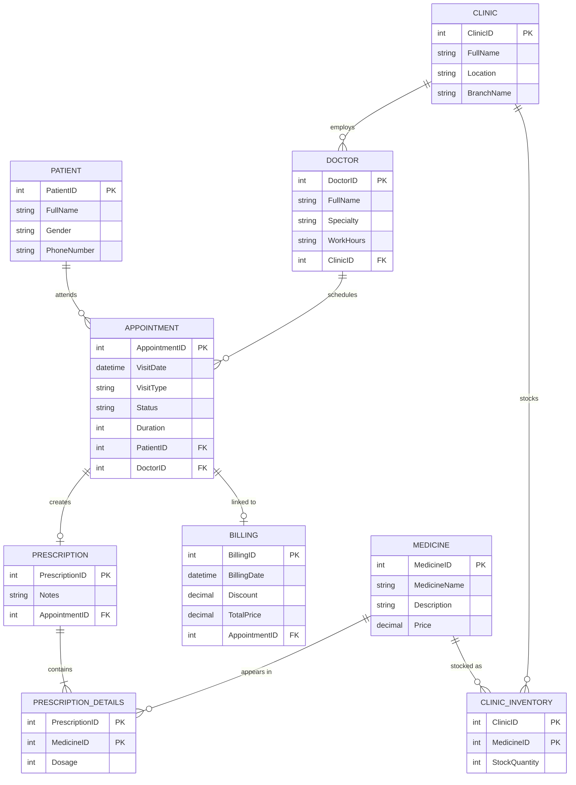

# Smart Healthcare Clinic Network

A database design for a network of clinics in different cities. It stores patients, doctors, appointments, prescriptions, billing, and medicine stock for each branch.

## What it does

- Keeps patient and doctor information
- Books appointments between patients and doctors
- Records prescriptions and the medicines in them
- Tracks the bill for each appointment
- Tracks medicine stock separately for each clinic
- Limits who can see medical and financial data

## ER Diagram

## Relationships

| Relationship | Type |
|---|---|
| Patient - Appointment | One to many |
| Doctor - Appointment | One to many |
| Clinic - Doctor | One to many |
| Appointment - Prescription | One to one |
| Appointment - Billing | One to one |
| Prescription - Medicine | Many to many (table: Prescription_Details) |
| Clinic - Medicine | Many to many (table: Clinic_Inventory) |

## Tables

Patient, Clinic, Doctor, Appointment, Prescription, Medicine, Billing, Prescription_Details, Clinic_Inventory.

The final tables are in [database-design.md](database-design.md).

## Normalization

The design is in 3NF. `ClinicID` was removed from Appointment and Billing because the clinic can already be found through the doctor. Details are in the design file.

## Reports

1. Patients with more than 2 appointments in the last month
2. Doctors by specialty in a given city
3. Prescriptions written by a doctor in a time period
4. Medicines with low stock in each location
5. Appointments longer than 30 minutes
6. Revenue per clinic

## Security

Access is based on roles (doctor, billing staff, admin staff, patient). Each role only sees the data it needs. Data is protected with encryption. See [security.md](security.md).

